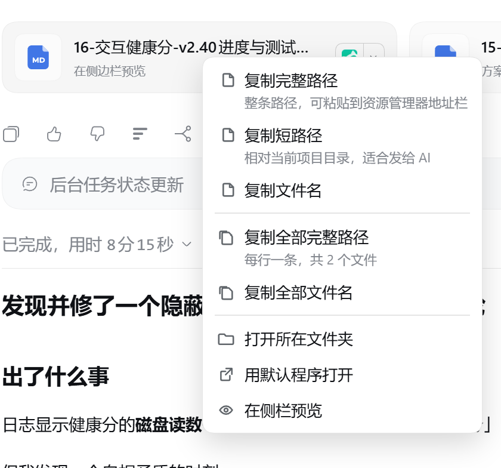
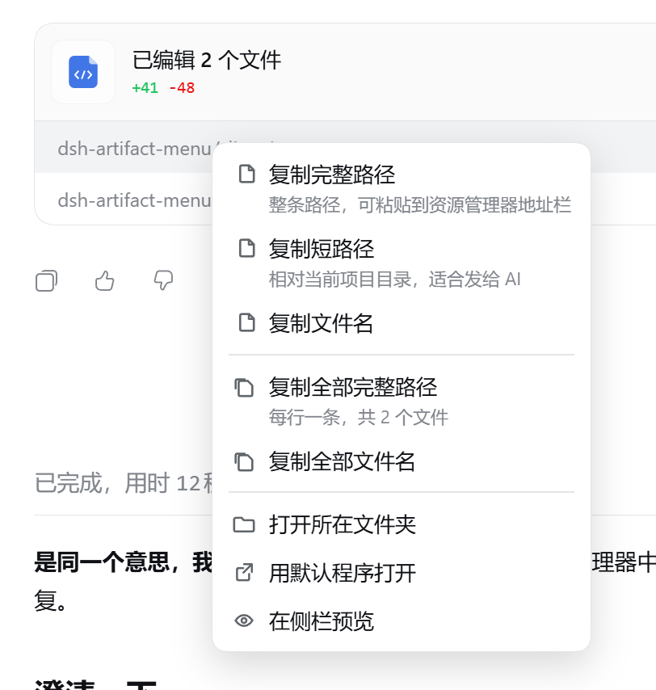
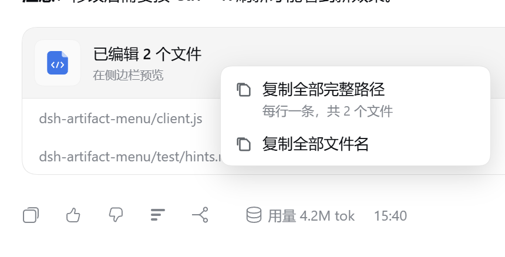
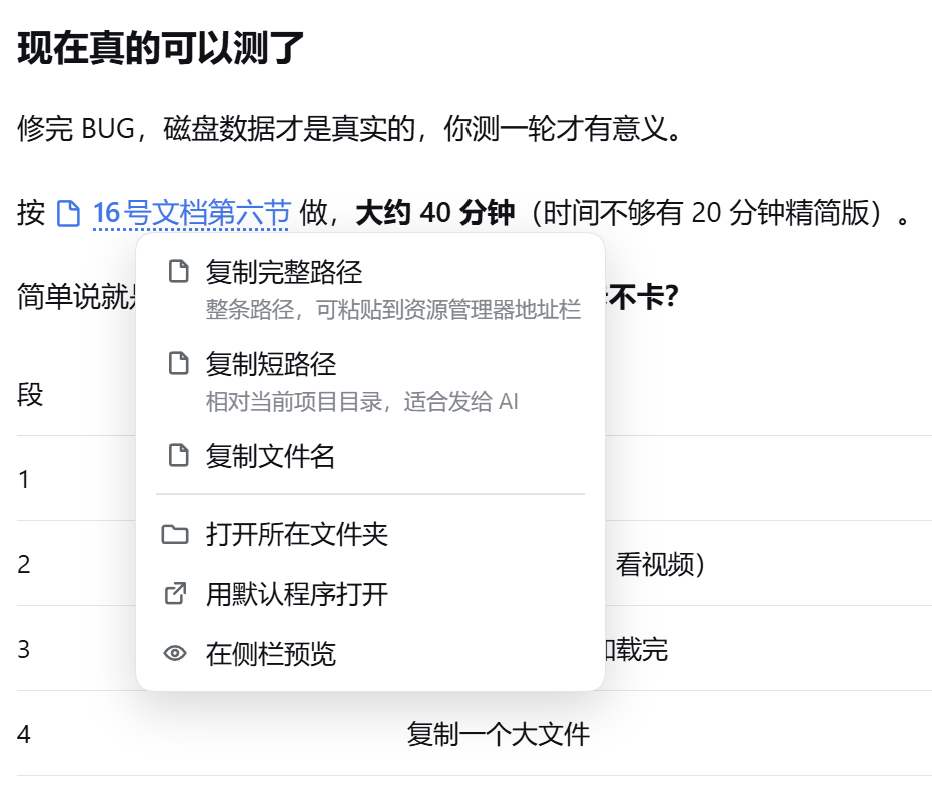
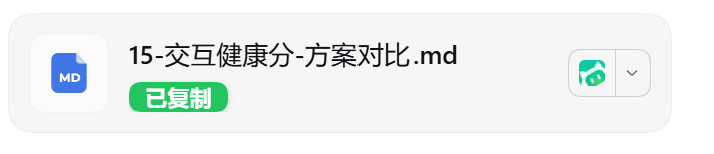

# 产物右键菜单 · dsh-artifact-toolkit

> 给 DeepSeek Harness 会话里的**产物卡片**、**已编辑文件卡片**和**正文里的文件链接**加上右键菜单。
> 复制路径、打开文件夹、用默认程序打开 —— 一次右键，不用再点开卡片。



---

## 解决的问题

用 AI 干活时，产物会以卡片形式出现在对话里。以前想拿到文件路径，只有一条路：**点开卡片 → 在侧边栏预览 → 从别处复制**。

这在几种常见场景下很别扭：

| 场景 | 以前 | 现在 |
|---|---|---|
| 想把文件发给同事 | 手动拼路径，或者去资源管理器里翻 | 右键 →「复制完整路径」 |
| 想让 AI 继续改这个文件 | 复制全路径，太长，AI 还得自己找 | 右键 →「复制短路径」 |
| 想用别的软件打开它 | 点开预览，再从预览里找打开按钮 | 右键 →「用默认程序打开」 |
| 想知道这文件在哪个文件夹 | 复制路径，粘到资源管理器，去掉文件名 | 右键 →「打开所在文件夹」 |
| 一轮改了 4 个文件，都要路径 | 复制 4 次 | 右键 →「复制全部完整路径」，一次到手 |

**核心就是一句话：把「找到文件 → 拿到它的路径 → 拿去用」的三步，压成一次右键。**

---

## 针对三种不同产出的设计

DSH 里的文件引用有三种形态，长得不一样，用法也不一样。插件对每种都单独做了适配。

### 一、产物卡片（`present` 交付的文件）


这是 AI 主动「交付」给你的文件，卡片上有文件名、说明，右边还有官方自带的「打开方式」按钮。

- **右键整张卡片**即可
- 菜单给出**全部 8 项**
- 如果这一行有多个产物，还会多出「复制全部」系列

### 二、已编辑文件卡片



这是 AI 改过的文件，标题显示「已编辑 N 个文件」和增删行数，下面逐行列出文件路径。

- **单文件卡片**：右键整张卡片
- **多文件列表**：右键**哪一行就操作哪个文件**，同时额外提供「复制全部」
- 左键点行的行为完全不变，右键只是多开了一个入口



### 三、正文里的文件链接



AI 在正文里提到文件时，会渲染成这种蓝色带图标的小链接（例如「按 `16号文档第六节` 做」）。它穿插在文字中间，没有卡片那样的空间。

- **右键这条链接**，菜单只有 6 项（没有「复制全部」，因为它只是一个文件）
- 路径取自链接内部记录的完整目标；如果链接只有名字、拿不到真实路径，**保持浏览器原生右键，不做猜测**——宁可不响应，也不给你一条错路径

---

## 菜单项一览

| 分组 | 菜单项 | 第二行说明 | 复制出来的样子 |
|---|---|---|---|
| 复制 | **复制完整路径** | 整条路径，可粘贴到资源管理器地址栏 | `C:\Users\you\项目\报告.md` |
| 复制 | **复制短路径** | 相对当前项目目录，适合发给 AI | `报告.md` 或 `docs/报告.md` |
| 复制 | 复制文件名 | — | `报告.md` |
| 复制 | 复制全部完整路径 | 每行一条，共 N 个文件 | 多行，每行一条完整路径 |
| 复制 | 复制全部文件名 | — | 多行，每行一个文件名 |
| 打开 | 打开所在文件夹 | — | 资源管理器打开并选中该文件 |
| 打开 | 用默认程序打开 | — | 用系统默认程序打开 |
| 打开 | 在侧栏预览 | — | 等价于点一下卡片 |

**为什么只有前两项有第二行说明？**
因为「完整路径」和「短路径」名字看着接近，复制出来的东西却完全不同，而选错了**不会报错**——你可能粘到一半才发现不对。其余各项的名字已经说清了用途，保持单行更清爽。

---

## 复制之后有反馈

复制成功后，卡片上会给出确认，不用去别处找。

**交付卡片**：文件名下方那行（平时写着「在侧边栏预览」）会变成绿底白字的标签：



**没有这一行的对象**（已编辑卡片的单行文件、正文行内链接）：窗口底部弹一条轻提示，不遮挡正文：


1.4 秒后自动消失。失败时提示变红色，并说明是哪一步失败了。

---

## 安装

### 前置条件

已安装 [DeepSeek Harness](https://github.com/deepseek-ai/deepseek-harness) 桌面版，并且有可用的 profile（默认 `desktop`）。

### 方式一：npm 安装（最简单）

```bash
dsh plugin add dsh-artifact-toolkit --profile desktop
```

或者在 DSH 里新开一个会话，直接说：

> 帮我安装这个 DSH 插件：`dsh-artifact-toolkit`

Agent 会用 `plugin_manager` 完成安装和启用。

### 方式二：手动安装（本地开发）

1. 把插件包放到任意目录，例如 `D:\plugins\dsh-artifact-toolkit`
2. 编辑 profile 的 `package.json`（位置：`%USERPROFILE%\.dsh\profiles\desktop\package.json`）：

   ```json
   {
     "dependencies": {
       "dsh-artifact-toolkit": "link:D:/plugins/dsh-artifact-toolkit"
     },
     "dsh": {
       "profile": {
         "bundles": [
           "……原有内容……",
           "dsh-artifact-toolkit"
         ]
       }
     }
   }
   ```

3. 在 `%USERPROFILE%\.dsh\profiles\desktop\node_modules\` 下建一个目录联接指向插件目录：

   ```powershell
   New-Item -ItemType Junction `
     -Path "$env:USERPROFILE\.dsh\profiles\desktop\node_modules\dsh-artifact-toolkit" `
     -Target "D:\plugins\dsh-artifact-toolkit"
   ```

4. **重启 DSH**

### 确认装好了

重启后打开任意会话，**右键一张产物卡片**，应该弹出菜单。
也可以在「设置 → 插件」里看到「产物右键菜单」这一项。

---

## 使用

| 想做什么 | 怎么做 |
|---|---|
| 拿到完整路径 | 右键卡片/链接 →「复制完整路径」 |
| 让 AI 能直接读到的路径 | 右键 →「复制短路径」，粘回对话里 |
| 用别的软件打开 | 右键 →「用默认程序打开」 |
| 在文件夹里看它 | 右键 →「打开所在文件夹」 |
| 一轮改的一堆文件都要路径 | 右键多文件卡片 →「复制全部完整路径」 |

**键盘也能用**：右键弹出菜单后，`↑` `↓` 移动，`Enter` 执行，`Esc` 关闭（关闭后焦点回到原处）。

---

## 设计取舍

这些是有意为之的选择，不是没做完：

**不做删除、重命名。**
在对话界面里放个删除按钮，误点一下就丢数据。文件管理该在文件管理器里做。

**认不出来就不管，绝不猜路径。**
正文里有些链接只记录了显示名，没有真实路径。插件遇到这种情况会**让浏览器原生右键照常弹出**，而不是拼一个可能是错的路径给你。

**不改动 DSH 本体。**
插件只读取卡片上已有的 DOM 信息（`title`、`aria-describedby` 等无障碍属性）来识别文件，不注入、不劫持、不修改任何官方组件。DSH 原生功能一样不受影响——右键卡片以外的地方，永远是浏览器原生菜单。

**失败时不静默。**
每个动作失败都会说明是哪一步失败、原因是什么，不会笼统地说一句「出错了」。

---

## 兼容性

| 项目 | 说明 |
|---|---|
| DSH 版本 | 0.2.1-rc.5 实测可用 |
| 平台 | Windows / macOS / Linux（打开文件夹、用默认程序打开需要本机是桌面环境） |
| 远程场景 | 从别的电脑用浏览器连进来时，「打开所在文件夹」和「用默认程序打开」不可用，菜单会提示；复制类功能照常 |
| 第三方依赖 | **零**。只用到 React（DSH 自带），不需要构建、不需要打包 |

---

## 已知限制

- **依赖 DSH 卡片的内部标记**（`data-presented-file`、`data-changed-files`、`data-ref-chip` 等）。DSH 将来大改版若改了这些标记，右键会失效。**失效时不会报错、不会弄坏页面**，只是退回浏览器原生右键。
- 「打开所在文件夹」需要本机桌面环境，远程访问时不可用。
- 正文链接如果没有记录完整路径，右键保持原生行为（见上面的设计取舍）。

---

## 开发

**改代码不用重启。** DSH 每 500 毫秒检查一次插件的 `client.js`，改动会自动热更新到已打开的页面，几秒内生效。只有改 `package.json`、`cordis.patch.yml` 这类组合配置时才需要重启。

### 跑测试

```bash
cd dsh-artifact-toolkit
node test/selftest.mjs    # 路径处理 + 两种卡片识别
node test/badge.mjs       # 复制提示的位置、样式、还原
node test/inline.mjs      # 正文行内链接识别（两种形态）
node test/menu-items.mjs  # 每种卡片出现哪些菜单项
node test/actions.mjs     # 每个菜单项走哪条路径、失败说什么
node test/keyboard.mjs    # 键盘操作与关闭行为
node test/wiring.mjs      # 服务声明完整性
node test/hints.mjs       # 哪些行该有说明、哪些该单行
node test/locales.mjs     # locale 文件与运行时词条一致性
node test/readme.mjs      # README 的说法与代码一致
node test/rename.mjs      # 包名、profile 配置与解析一致性
node test/pack.mjs        # 发布包内容干净、无本机路径
```

十二套共 **219 项**检查，不需要浏览器和 DSH，纯 Node 即可运行。

### 文件结构

```
dsh-artifact-toolkit/
├── package.json        包声明（dsh.bundle + dsh.client）
├── cordis.patch.yml    把插件行插进 profile 组合
├── screenshots.json    插件市场用的截图清单
├── index.js            Host 半侧（本插件无 Host 逻辑）
├── client.js           全部功能：右键监听、菜单、复制、打开
├── icon.svg            插件列表图标（矢量源）
├── locale/
│   ├── zh.json         中文显示名与描述
│   └── en.json         英文
├── docs/images/        README 用图 + 市场图标 icon-180.png
└── test/               离线自测
```

### 发布检查

```bash
npm pack --dry-run    # 确认清单只有 17 个文件、无本机路径
node test/pack.mjs    # 自动核对上面这一点
```

---

## 许可

MIT © 2026 dsh-artifact-toolkit contributors

---

## 相关

- [DeepSeek Harness](https://github.com/deepseek-ai/deepseek-harness)

---

如果这个插件帮你省了几次复制粘贴，欢迎点个 ⭐。
